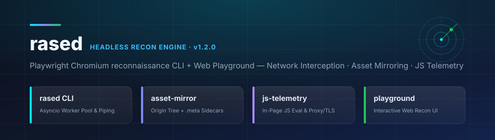

<div align="center">



<br/>

**محرّك استطلاع أمني احترافي (`Rased — راصد`) مبني على Playwright Chromium و`asyncio` مع لوحة تحكّم ويب تفاعلية — يعترض جميع طلبات الشبكة، ويحفظ شجرة الملفات مع بيانات `.meta` الكاملة، وينفّذ شيفرات JavaScript مباشرةً داخل سياق الصفحة.**

[](https://github.com/abduallahJamal/rased/actions/workflows/validate.yml)
[](pyproject.toml)
[](rased/browser.py)
[](#مرجع-أوامر-الطرفية-cli)
[](dashboard/server.py)
[](LICENSE)

**[🇬🇧 English](README.md)** · **🇪🇬 العربية**

</div>

---

<div align="right" dir="rtl">

## 📌 لماذا أداة راصد (`Rased`)؟

أدوات الجلب التقليدية مثل `curl` و`httpx` تكتفي بقراءة هيكل HTML الأولي فقط، فتفوتها **حزم JavaScript المحمّلة ديناميكياً، وطلبات XHR/fetch الخلفية، وحالة الـ DOM الفعلية، وترويسات الأمان مثل `CSP`** في تطبيقات الويب الحديثة (SPAs). صُمِّم **راصد (`rased`)** — المستوحى من أداة Detectify `page-fetch` — ليقود متصفح **Chromium** حقيقي بالوضع الخفي عبر مجمّع عمال `asyncio` سريع، مع **واجهة ويب تفاعلية (Playground)** مدمجة.

| القدرة | أدوات الجلب التقليدية (`curl` / `httpx`) | مع محرّك **`rased` (راصد)** |
| :--- | :--- | :--- |
| **تطبيقات SPA وحزم JS الديناميكية** | لا ترى الملفات والطلبات المولّدة بعد التحميل | تشغيل فعلي لمتصفح **Chromium** واعتراض كل حدث `response` |
| **حفظ الأصول والبيانات الوصفية** | حفظ النص الخام فقط بدون سياق | بناء شجرة `out/<host>/<path>` تلقائياً + ملف **`.meta` JSON** لكل مورد |
| **تنفيذ JavaScript داخل الصفحة** | غير متاح بدون متصفح | الخيار `-j "<expr>"` يُنفَّذ داخل الصفحة ويُطبع على `stdout` ببادئة `[JS]` |
| **التحكم في النطاق والفلترة** | يتطلب سكربتات تصفية إضافية | فلاتر مدمجة: `--no-third-party`، `--third-party`، `--include`، و`--exclude` |
| **التمرير عبر Burp Suite / ZAP** | إعدادات متفرقة لكل أداة | دعم مباشر للبروكسي `HTTP/SOCKS5` عبر `-p` وتجاوز أخطاء الشهادات `-k` |
| **الاستكشاف البصري المباشر** | سطر أوامر فقط | **لوحة تحكّم ويب تفاعلية** (`rased-dashboard`) لتجربة الاستطلاع وفحص الأصول بصرياً |

---

## 🧩 المكوّنات الأساسية للنظام

### ١. مجمّع العمال المتزامن وأوامر الطرفية (`rased/cli.py` + `rased/worker.py`)
يستقبل الروابط عبر الأنابيب (`cat urls.txt | rased`) أو من ملف `-f` أو كوسائط مباشرة، مع توحيد تلقائي لبادئة `https://` وإزالة التكرارات مع الحفاظ على الترتيب. يدير عدد `-c` من العمال المتوازيين مع فاصل زمني `-d` وإغلاق آمن لعمليات Chromium عند إشارات `SIGINT`/`SIGTERM`، ويثبّت الأمر `rased` مع الاسمين البديلين `page-fetch` و`pfetch`.

### ٢. إدارة المتصفح واعتراض الشبكة (`rased/browser.py`)
ينشئ سياق تصفّح معزولاً (`BrowserContext`) لكل رابط مستهدف (مع دعم User-Agent مخصص والبروكسي)، ويرصد كل طلب واستجابة لحساب زمن الاستجابة بالملي ثانية (`latency_ms`)، ثم ينفّذ تعبيرات JavaScript المتزامنة أو غير المتزامنة بأمان تام.

### ٣. المرآة المحلية الآمنة وملفات `.meta` (`rased/storage.py` + `rased/utils.py`)
يعيد بناء مسارات الموقع تحت `out/<host>/<path>` مع تطهير أسماء الملفات ومنع ثغرات تجاوز المسار (`Path Traversal`)، ويدعم التسمية التزايدية الذرية (`script.1.js`) أو الكتابة المباشرة (`-w`)، ويولّد ملف `.meta` بصيغة JSON بجانب كل ملف محفوظ.

### ٤. لوحة التحكم التفاعلية (`dashboard/server.py` + `dashboard/index.html`)
واجهة ويب داكنة وخادم REST محلي (`POST /api/fetch` و`GET /api/health`) لتشغيل عمليات الجلب مباشرةً من المتصفح واستعراض الأصول الملتقطة ومخرجات JavaScript وملفات `.meta`.

---

## 🚀 التثبيت السريع

</div>

```bash
git clone https://github.com/abduallahJamal/rased.git
cd rased

python3 -m venv .venv
source .venv/bin/activate

# تثبيت حزمة rased وأوامر الطرفية
pip install -e .

# تثبيت متصفح Chromium الخاص بـ Playwright
playwright install chromium
# أو على خوادم Linux الجديدة لتثبيت مكتبات النظام أيضاً:
playwright install --with-deps chromium
```

<div align="right" dir="rtl">

> **ملاحظة:** يمكنك تعيين المتغير `CHROME_PATH=/usr/bin/google-chrome` لاستخدام متصفح مثبت مسبقاً على النظام بدلاً من تنزيل متصفح جديد.

---

## ⚡ أمثلة البدء السريع

### ١. التمرير عبر الأنابيب (`stdin`) والربط مع أدوات الاستطلاع

</div>

```bash
echo "https://example.com" | rased
cat examples/urls.txt | rased -o recon -c 5 --no-third-party -v
```

<div align="right" dir="rtl">

### ٢. الفلترة حسب النوع أو النطاق

</div>

```bash
# استبعاد الصور والخطوط لتسريع الفحص وتوفير المساحة
cat urls.txt | rased --exclude "image/" --exclude "font/" -o recon

# جمع ملفات JavaScript فقط لتحليل المسارات والأسرار
cat urls.txt | rased --include ".js" --include "javascript" -o js-bundles

# جمع الموارد الخارجية فقط (شبكات CDN وأدوات التتبع)
cat urls.txt | rased --third-party -o thirdparty
```

<div align="right" dir="rtl">

### ٣. استخراج البيانات عبر تنفيذ JavaScript داخل الصفحة (`-j`)

</div>

```bash
echo "https://example.com" | rased -j "document.title"
echo "https://example.com" | rased -j "Array.from(document.scripts).map(s=>s.src)"
echo "https://example.com" | rased -j "JSON.stringify(performance.getEntries().map(e=>e.name))"
```

<div align="right" dir="rtl">

### ٤. التوجيه عبر Burp Suite أو OWASP ZAP

</div>

```bash
rased -f urls.txt -p http://127.0.0.1:8080 -k -o burp-mirror
```

<div align="right" dir="rtl">

### ٥. تشغيل لوحة التحكم التفاعلية (Web Playground)

</div>

```bash
rased-dashboard
# أو مباشرة: PORT=8787 python3 dashboard/server.py
```

<div align="right" dir="rtl">

ثم افتح الرابط `http://localhost:8787` في متصفحك. لمزيد من مسارات العمل الأمنية راجع **[أمثلة الاستخدام بالعربية](docs/usage-examples.md)** و**[English Usage Examples](docs/usage-examples.en.md)** و**[وصفات استخراج JavaScript](examples/js-snippets.md)**.

---

## 📖 مرجع أوامر الطرفية CLI

</div>

```text
usage: rased [-h] [-f PATH] [URL ...] [-c N] [-d MS] [-t MS]
             [--wait-until {load,domcontentloaded,networkidle,commit}]
             [--exclude STR] [--include STR]
             [--no-third-party] [--third-party]
             [-j EXPR] [-p URL] [-k] [-A UA]
             [-o DIR] [-w] [-v] [--headed] [--version]
```

<div align="right" dir="rtl">

| الخيار | الوظيفة | القيمة الافتراضية |
| :--- | :--- | :--- |
| `-f, --file PATH` | قراءة الروابط من ملف نصي (سطر لكل رابط مع تجاهل `#`) | — |
| `-c, --concurrency N` | عدد العمال المتوازيين في مجمّع `asyncio` | `3` |
| `-d, --delay MS` | التأخير بالملي ثانية بين الطلبات لكل عامل | `0` |
| `-t, --timeout MS` | مهلة تحميل الصفحة بالملي ثانية | `30000` |
| `--wait-until COND` | شرط اكتمال التحميل (`load`, `domcontentloaded`, `networkidle`, `commit`) | `networkidle` |
| `--exclude STR` | استبعاد الموارد المطابقة لنوع MIME أو جزء من الرابط (قابل للتكرار) | — |
| `--include STR` | الاقتصار على الموارد المطابقة فقط (قابل للتكرار) | — |
| `--no-third-party` | حفظ موارد النطاق المستهدف ونطاقاته الفرعية فقط | معطّل |
| `--third-party` | حفظ موارد الأطراف الخارجية فقط | معطّل |
| `-j, --javascript EXPR` | تنفيذ تعبير JavaScript في سياق الصفحة وطباعة الناتج على `stdout` | — |
| `-p, --proxy URL` | تمرير الاتصالات عبر بروكسي `HTTP` أو `SOCKS5` | — |
| `-k, --insecure` | تجاهل أخطاء شهادات TLS/SSL (للاستخدام مع Burp/ZAP) | معطّل |
| `-A, --user-agent UA` | تخصيص ترويسة `User-Agent` | `Rased/1.2.0` |
| `-o, --output DIR` | مجلد حفظ المخرجات | `./out` |
| `-w, --overwrite` | الكتابة فوق الملفات الموجودة بدلاً من الترقيم التزايدي (`app.1.js`) | معطّل |
| `-v, --verbose` | إظهار تفاصيل كل ملف تم حفظه أو تخطيه | معطّل |
| `--headed` | تشغيل المتصفح بواجهة مرئية لأغراض التصحيح | معطّل |

---

## 🔒 ضوابط الاستخدام الأمني

- **الاختبار المصرّح به فقط:** استعمل أداة `rased` حصراً على الأنظمة والنطاقات التي تملكها أو لديك تصريح رسمي باختبارها (برامج مكافآت الثغرات والتقييمات الأمنية المصرّح بها).
- **تجاهل أخطاء الشهادات (`-k`):** لا تُفعّل الخيار `-k` إلا عند التمرير عبر بروكسي اعتراض محلي موثوق مثل Burp Suite أو OWASP ZAP.
- **عزل وتطهير المسارات:** يتم تطهير كافة أسماء النطاقات والمسارات والاستعلامات تلقائياً لمنع أي محاولة لتجاوز المجلد المحلي (`Path Traversal`).

---

## 🤝 المساهمة والترخيص

المساهمات مرحّب بها عبر [دليل المساهمة](CONTRIBUTING.md). قبل إرسال أي طلب دمج (Pull Request) شغّل الفحص والاختبارات:

</div>

```bash
python3 scripts/validate.py
pytest -v
```

<div align="right" dir="rtl">

مرخّص بموجب رخصة [MIT](LICENSE) © 2026 عبد الله جمال (Abduallah Jamal).

</div>
